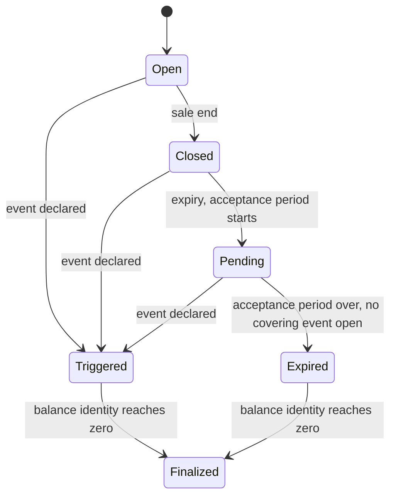

# MarketFactory and Series design note

Status: Draft, for review before any contract code · Date: October 11, 2026

Source: technical-doc.md v1.5 Changelog, Section 4.4, 5.9, 8.6, 9, 10, 11.1, 11.5, 12.4, 12.5, 12.7, 15, 16, 17.3, 21; ADR-001, 003, 004, 012; `docs/design/event-registry.md` (format and deviation 15).

Scope: `MarketFactory` (`initialize`, `open_series`, `reserve_cover`, `release_cover`, `set_series_wasm`, `upgrade`, `migrate`, every Section 12.4 read) and `Series` (`__constructor`, `deposit`, `quote`, `cancel_quote`, `withdraw`, `transfer_position`, `buy_cover`, `claim`, `claim_for`, `trigger`, `sync`, the SEP-41 cover token, every Section 12.5 read). Also in scope, as the last commit of the implementation PR: replacing `EventRegistry.version_has_live_cover`'s stand-in with a real query to `MarketFactory`, closing `docs/design/event-registry.md`'s own deviation 15. Out of scope, each its own later PR: the demo build (Step 3, after this merges), and the real `PriceGuard`/price adapters (shipped here as a mock; the real adapter is `contracts/adapters`' own future work, and its existing stub signatures are not reused — see Section 2).

## 1. State machine



| From | To | Trigger | Who | Exact time condition |
| --- | --- | --- | --- | --- |
| None | Open | `MarketFactory.open_series` deploys the series | Governor (v1) | At deploy, `terms.start` |
| Open | Closed | `sync()`, or lazily inside any state-changing call | Anyone | `now >= sale_end = terms.expiry - sale_cutoff_secs` (default 3 days) |
| Closed | Pending | `sync()` | Anyone | `now >= terms.expiry` |
| Pending | Expired | `sync()` | Anyone | `now >= terms.expiry + longest window_len(kind)` among covered kinds (Section 8.6) AND no event covering this series is Proposed, Challenged or Escalated for any covered kind |
| Open / Closed / Pending | Triggered | `sync()`; `trigger()` is `sync()` plus an assertion the result is Triggered (Section 7) | Anyone | `EventRegistry.covers(event_id, def_version, terms.start, terms.expiry)` is true for some Declared event under a kind+version this series pins |
| Triggered / Expired | Finalized | `sync()` (Section 7) | Anyone | The series' own tracked balance identity (Section 10.3) is zero: `total_collateral + total_premium - total_paid - total_withdrawn == 0` |

Every state-changing call (`deposit`, `quote`, `cancel_quote`, `withdraw`, `transfer_position`, `buy_cover`, `claim`, `claim_for`, `trigger`, `sync`) runs the same `sync_state()` first, so no transition above is reachable only through a dedicated function; `sync()` is the public entry point for anyone who wants to force it without doing anything else, matching this codebase's existing permissionless-forcing-function pattern (`EventRegistry.finalize`/`resolve_timeout`/`checkpoint_cure`). On reaching Expired or Triggered, `sync_state()` calls `MarketFactory.release_cover`, which also drops the series from the factory's live list (Section 9.2).

## 2. Sales gating: feed staleness and the price guard (M1, M2, M3)

Fully specified by the v1.5 changelog and Section 9.4; restated here only because `buy_cover`'s step order depends on it.

- **M1, `FeedBehind`:** `buy_cover` rejects unless the asset's newest posted sub-epoch (`RiskOracle.live(asset)`) is the last one that closed, or the one before it within `feed_grace_secs` (default 120s) of that sub-epoch's own close. Checked after `cover_gate`, before the price guard.
- **M2, `PriceGuard`:** an optional per-asset client, `PriceGuard.check(asset) -> GuardStatus { Ok, Paused, Unavailable }`. `buy_cover` calls it only if one is configured for the asset; `Paused` or `Unavailable` rejects with `FastSignalPause` (already reserved as error 516). It never gates `claim`, `trigger`, `withdraw`, or any read. Shipped here with a mock implementing the trait below; the real adapter is out of scope. **Deliberately not built on `contracts/adapters/{amm-soroswap,fx-reference}`'s existing stub signatures** (`spot_price(_,_) -> (i128,i128)`, `rate(_,_) -> i128`) — those already don't match what `RiskOracle::clients.rs` expects (a 3-tuple with timestamp, and `(code, FxRateSource) -> (i128,u64)` respectively), and `PriceGuard` is a distinct concern (a fast, sale-only pause signal, not a price or FX read). The trait:

  ```rust
  pub trait PriceGuard {
      fn check(env: Env, asset: Address) -> GuardStatus;
  }
  ```

- **M3, no per-purchase waiting period:** cover units are fungible within a series, so a purchase cannot carry its own start time distinct from every other unit's. M1, M2 and `cover_gate` (Section 8's existing informed-buying block) do that job collectively: a buyer who purchases moments before a real failure starts is blocked by one of them, not by a per-purchase timer. No separate mechanism is added.

## 3. Storage lifetime (M4): the TTL policy, with real numbers

Section 15.2's table states the target lifetimes in time, not ledger counts, and leaves the exact numbers to this note. At 5 seconds per ledger (the same assumption `deploy/extend-ttl.sh` already uses):

| Entry class | Contracts | Extended by | Extend to | Re-extend when remaining TTL drops below |
| --- | --- | --- | --- | --- |
| Instance (`Terms`/`State`/`Totals`/`Quotes` bundle; `Config`/`SeriesCounter` bundle) | Series, MarketFactory | Every state-changing call | 518,400 ledgers (30 days) | 345,600 ledgers (20 days) |
| Persistent (`Position(seller)`, the cover token's `Balance(holder)`; `OpenCover(asset)`, `Deployed(series)`, `SeriesList(asset)`) | Series, MarketFactory | Every write, and every hot-path read (below) | 6,307,200 ledgers (365 days) | 5,184,000 ledgers (300 days) |

The instance target (30 days) deliberately matches `deploy/extend-ttl.sh`'s own `EXTEND_TARGET_LEDGERS` exactly: once this ships, that script's periodic sweep becomes a redundant safety net for these two contracts' instance entries rather than the only thing keeping them alive, the same way it already is for the four core contracts once issue #28's real fix lands through `upgrade()`. The persistent target (365 days) matches Section 15.2's own explicit "minimum 1 year" floor for Series positions and cover balances; the 65-day re-extension margin is deliberately wide, since a seller or holder who never touches their own position should not need anyone else to rescue it before a year is up.

**Hot-path reads that extend persistent TTL, not only writes:** `position(seller)` (read by `withdraw`, `transfer_position`, and display) and the cover token's own `balance(holder)` (the standard SEP-41 read, called by wallets and the explorer on every visit). A read-triggered extension only re-extends; it never shortens or lapses an entry a write already covers.

`Allowance(from, spender)` (SEP-41) stays temporary per Section 15.1, unaffected by this policy — a temporary entry is deleted, not archived, on expiry, which is the correct behavior for an allowance (re-approving is cheap and expected).

## 4. Collateral token and settlement (M5)

Settlement is the protocol USDC address — TUSD on testnet, real USDC-equivalent on mainnet once Governor sets it. The two settlement rules from Section 9.7 are kept exactly as written: `settlement != asset`, and the settlement asset must not share the covered asset's issuer (checked via the settlement SAC's `name()`, `CODE:ISSUER` for a classic asset). No change.

## 5. Upgrades (lead decision)

`MarketFactory` is a core contract (Section 17.3's list) and needs `upgrade(wasm_hash)`, governor-only. The shared helper for this (issue #12, adding `upgrade()`/`migrate()`/`version()` to the four existing core contracts) has not merged as of this pull (`main` at `ac93428`), but its shape is already agreed:

```rust
// sylox_types::upgrade
pub fn do_upgrade(env: &Env, admin: &Address, new_wasm_hash: BytesN<32>);
// admin auth, the Wasm swap, emits Upgraded { contract, old_version, new_wasm_hash }
// (old_version read from the running code's own version() constant)

pub fn do_migrate(env: &Env, admin: &Address, target_version: u32) -> bool;
// false if target_version was already applied; the contract maps false to its own AlreadyMigrated error
```

**Decision:** `MarketFactory` builds against these exact signatures now, as 2-3 line wrappers (`upgrade()`, `migrate()`, `version()`) reading `governor` from its own `Config`, the same shape the four existing contracts will carry. If issue #12 has merged by the time the implementation PR lands, it uses the real helper; if not, it codes against these signatures and rebases once #12 lands. No separate, bespoke upgrade path is written either way. `Series` has no `upgrade()` at all (Section 17.3: not upgradeable; `set_series_wasm` only affects series opened afterward).

## 6. Related seller block list (lead decision)

Section 11.5: "Related seller block list: Issuer and declared affiliates, enforced in `Series.deposit`, list in `Governor`." `Governor` is currently a 25-line stub with no such list.

**Decision:** the list is stored on `MarketFactory`, per asset, not globally — Section 11.5's own wording ("the issuer and declared affiliates") is already asset-specific, since every asset has a different issuer. `MarketFactory` gains:

- `RelatedSellers(asset)`, persistent, a `Vec<Address>`, governor-only setter (`set_related_sellers(asset, list)`).
- `open_series` refuses an asset whose list has never been set at all (new error, `RelatedSellerListNotSet`, 407), so the issuer can never be missing from the list by omission. An explicitly empty list is allowed, but has to be set on purpose, not left at a default.
- `Series.deposit` and `Series.transfer_position` both query `MarketFactory.related_sellers(asset)` and reject a listed address with the existing `RelatedSeller` error (510, already reserved in Section 14's table) — Section 16's own role table already scopes "Seller" as "anyone not on the related seller list," covering transfer as well as deposit, not deposit alone.

This is not a stand-in the way the testnet admin key stands in for Governor's signature scheme: it uses the same trust model every other governor-gated call in the four merged contracts already uses (an address the contract is told is "the governor," never Governor's own internals), so there is no rework needed once a real `Governor` exists — only a question of which contract ends up holding the setter, raised in Section 17 below. The list is **not** auto-populated from the SAC's `admin()` field; see the same section.

## 7. Lazy sync, trigger, and Finalized (lead decision)

Three points the spec's prose leaves to infer, stated explicitly so the implementation and the property test in Section 15 agree on the same behavior:

- **`sync()` is the one place every transition in Section 1 is decided**, from stored timestamps and `EventRegistry` state, never from the time of the call itself. `trigger()` calls the same `sync_state()` and then asserts the result is `Triggered`, returning `event_id`; it has no transition logic of its own. This also means lazy syncing cannot change the final outcome of a given sequence of external events, regardless of when (or how many times) anyone happens to call something — stated as invariant I24 below, because the alternative (an outcome that depends on timing of an unrelated, permissionless call) would be a real bug, not a cosmetic one.
- **Nothing proactively calls `sync()` on a dormant series.** Exactly like `EventRegistry.checkpoint_cure` (issue #20's own precedent), this is an operational responsibility: the keeper service (today, the `sylox-live-poster` Railway cron) calls `sync()` on every live series it knows about, as routine upkeep, the same way it will eventually call `checkpoint_cure` on every live Depeg event. This needs no code change here, only a line in that service's own scope once it exists.
- **Every read computes the logical state live, never trusting possibly-stale storage.** `state()` runs the same `sync_state()` logic (without committing a write if nothing changed) before returning, so a UI or indexer reading a series nobody has touched in weeks still sees the correct state, even though the contract's own stored `SeriesState` might lag until the next write.
- **`Finalized` is reached automatically, via `sync()`,** the moment the series' own tracked balance identity (Section 10.3) reaches exactly zero while in Triggered or Expired: `total_collateral + total_premium - total_paid - total_withdrawn == 0`. This is an O(1) check against aggregates `Series` already tracks, never an iteration over every seller's position, and is exact under invariant I3 — a direct donation can only ever push the real token balance above this computed zero, never below it, so a donation can never block reaching Finalized, only make the "balance ≥ expected" slack larger. Once Finalized, every write function returns `WrongSeriesState`; reads keep working until the entries' own TTL eventually lapses (Section 3).

## 8. Quote tie-breaking (lead decision)

Section 9.3/9.4 specifies "walk quotes from cheapest" but not which of two quotes at the same `rate_bps` fills first.

**Decision:** FIFO by `(rate_bps, sequence)`, where `sequence` is a new `u64` field on `Quote`, assigned from a per-series monotonic counter the moment a quote is created. Changing an existing quote's rate or size is **not** an update in place — it is treated as cancelling the old quote and creating a new one, which gets a fresh `sequence` and goes to the back of its new rate tier. A partially filled quote keeps its original `sequence` and its place in line for its remaining `available` amount. This is simple, matches how a real order book usually breaks a price tie, and gives re-quoting no way to jump ahead of an existing quote at the same rate.

## 9. The Series → Treasury fee deposit (lead decision)

Section 12.7 already specifies the pattern `buy_cover`'s fee deposit needs: "When a contract is the `from`, it authorizes the nested USDC transfer with `env.authorize_as_current_contract` before the call" — the same two-hop problem `Staking.deposit_treasury_share` already solves (`staking/src/lib.rs:1143`), because `Treasury.deposit`'s own `from.require_auth()` is a second hop past `Series`' direct call into it, which Soroban does not auto-authorize.

**Decision:** extract `deposit_treasury_share`'s authorization logic into `sylox_types` now, as its own tiny PR before `feat/markets`, used by both `staking` and `series` — a pure refactor, no behavior change, with `Staking`'s existing tests passing unchanged. The contracts agent is editing `Staking` for `upgrade()` (issue #12) concurrently; whichever of the two PRs merges second rebases onto the other. The diff inside `staking` itself stays as small as possible: replace the body of `deposit_treasury_share` with a call into the new shared helper, nothing else.

## 10. Closing `version_has_live_cover`

`EventRegistry::version_has_live_cover` (`event-registry/src/lib.rs:644`) is a single stand-in function returning `false` unconditionally, exactly as `docs/design/event-registry.md`'s own deviation 15 promised: "there is exactly one place to change when `MarketFactory` ships." Its replacement:

```rust
fn version_has_live_cover(
    env: &Env, config: &Config, asset: &Address, kind: EventKind, version: u32,
) -> bool {
    MarketFactoryClient::new(env, &config.factory)
        .series_for(asset)
        .iter()
        .any(|series| {
            SeriesClient::new(env, &series).terms().def_versions.get(kind) == Some(version)
        })
}
```

No signature or call-site change anywhere else in `EventRegistry`: both callers (`register_definition`'s `DefinitionInUse` guard, `propose_tier1`'s non-canonical-version acceptance check) already call this function and nothing else. `Config.factory: Address` is already wired through `initialize` and every test fixture as a placeholder, per that note's own design. `series_for` only returns live series (Section 12.4), so a series that has already reached Expired or Triggered (and been dropped from the factory's live list, Section 1) correctly stops pinning its version the moment it leaves, with no separate bookkeeping. This lands as the last, separate commit of the implementation PR, since it changes an already-deployed contract and reaches testnet through `upgrade()` rather than a redeploy.

## 11. Cost estimate: `buy_cover`

**This is a worst-case estimate, not a measurement** — no code exists yet to run a real budget test against. The implementation PR's own budget test (Section 15) must confirm or correct every number here; nothing below should be treated as load-bearing until it does.

Worst case: 64 quotes from 64 **distinct** sellers, each offering exactly enough that a single `buy_cover` call fills all 64 (the structural maximum `Quotes`' own 64-entry cap allows), with a `PriceGuard` configured for the asset.

| Dimension | Estimate | Basis | Limit | Margin |
| --- | --- | --- | --- | --- |
| Footprint entries | ≈ 81 | `cover_gate` (9, measured, `event-registry/src/budget_test.rs`) + `Series` instance (1) + `Position(seller)` × 64 (the dominant term) + `Series`' own USDC balance (1) + `MarketFactory.reserve_cover` (`Deployed`, `OpenCover`: 2) + `Treasury.deposit` (instance, USDC balance: 2) + cover token `Balance(buyer)` mint (1) + `PriceGuard.check` (1, worst case) | 400 | ≈ 4.9x |
| Write entries | ≈ 70 | Same as above, minus the pure reads (`cover_gate`'s 9, `Deployed` membership check) | 200 | ≈ 2.9x |
| Instructions | ≈ 15–20M | `cover_gate`'s own measured 9,602,712 at its structural cap, plus a reasoned allowance for the 64-fill walk and three cross-contract calls (`MarketFactory`, `Treasury`, the token transfers), by analogy with `EventRegistry`'s own measured cross-contract overhead (≈8.2–8.6M instructions for 2-3 hops, Section 15.3) | 400,000,000 | > 20x |
| Memory | < 3MB | `cover_gate`'s own measured 1,762,761 bytes at its structural cap, plus 64 small `Position` reads/writes | 41,943,040 | > 14x |

The dominant, least-certain term is the count of **distinct** sellers filled in one call — a realistic buy against a thin book (one or two large quotes) costs a small fraction of this; the number above is the structural ceiling the 64-quote cap allows, not a typical case. The real implementation PR's budget test should measure exactly the worst-case scenario stated above, not an average one, mirroring how `event-registry/src/budget_test.rs` measures its own gate at 73 unbuilt hours rather than a typical few.

## 12. New error codes

Appended at the end of each contract's own range, per Section 14's convention:

| Code | Name | Contract | Meaning |
| --- | --- | --- | --- |
| 406 | `AlreadyMigrated` | MarketFactory | `migrate(target_version)` called for a version already applied (Section 5) |
| 407 | `RelatedSellerListNotSet` | MarketFactory | `open_series` for an asset whose related-seller list has never been set (Section 6) |
| 517 | `FeedBehind` | Series | `buy_cover` rejected: the newest posted sub-epoch is older than the last closed one, outside `feed_grace_secs` (Section 2, M1) |

`FastSignalPause` (516) and `RelatedSeller` (510) already exist in Section 14's table and are reused as written, not duplicated.

## 13. Invariants

| Id | Invariant | Primary test |
| --- | --- | --- |
| I1 | Total cover units ≤ sum of sellers' collateral | Property test, after every op |
| I2 | Per seller, `cover_written <= collateral` | Unit test on every fill path; property test |
| I3 | USDC balance of a series ≥ expected balance (Section 10.3) | Assert `token.balance(series) >= expected` after every operation in every test |
| I4 | Cover units minted only in Open, only against a real fill | Unit test: `buy_cover` outside Open rejects before any mint; property test |
| I5 | Payouts only in Triggered, only for an event that covers the series | Unit test: `claim`/`claim_for` outside Triggered rejects; day-88 integration scenario |
| I6 | Premiums not withdrawable before Triggered or Expired | Unit test: `withdraw` in Open/Closed caps at `collateral - cover_written`, never includes `premium_earned`; property test |
| I9 | Sum of open cover per asset ≤ asset cap at purchase time, checked and reserved in one call | Unit test: concurrent-style `reserve_cover` calls against a tight cap; no separate read-then-reserve path exists to race |
| I10 | No role moves USDC out of a series except seller withdraw, holder claim, or the `Treasury` fee at purchase | Property test's own balance accounting; code review that no other `token.transfer` call site exists in `Series` |
| I11 | Series terms, including pinned definition versions, never change after `open_series` | Unit test: no `Series` function ever writes `Terms` after the constructor |
| I13 | Every live series pins the current canonical definition version of each kind it covers | Unit test on `open_series`'s `DefinitionNotCurrent` check; integration test with a definition superseded mid-series-life |
| I24 (new) | `sync()` is idempotent and order independent: the same sequence of external events (deposits, quotes, buys, a Declared event, time passing) produces the same final `SeriesState` and the same final balances regardless of when, or how many times, anything calls a state-changing function or `sync()` relative to those events | New property test variant: run the same event sequence twice, once syncing after every step and once syncing only once at the end; assert identical final state and balances |
| I25 (new) | No deposit or position transfer ever succeeds for an address on the asset's related-seller list, and `open_series` never succeeds for an asset whose list was never set | Unit tests: a blocked deposit, a blocked transfer, `open_series` refusing an unset list; only the governor can change the list |

I1, I2, I3, I4, I5, I6, I9, I10, I11 and I13 are this build's share of Section 21.1's existing invariants; I24 and I25 are new, introduced by this design note the same way the v1.5 sub-epoch revision introduced I21–I23.

## 14. Attacks

| Attack | What stops it |
| --- | --- |
| Re-quoting to jump a price tier's own queue | FIFO by `(rate_bps, sequence)`; changing a quote's rate or size is a new quote with a fresh `sequence`, sent to the back (Section 8) |
| The issuer, or a declared affiliate, selling cheap cover on its own asset | The related-seller block list, checked on both `deposit` and `transfer_position` (Section 6), not deposit alone |
| A keeper's ordinary posting lag spuriously blocking every sale | `feed_grace_secs` (M1, Section 2) tolerates one sub-epoch's worth of normal lag |
| A compromised or misbehaving `PriceGuard` freezing the whole market | `PriceGuard` only ever gates a new sale; it is never consulted by `claim`, `trigger`, or `withdraw` (M2, Section 2) |
| Buying cover the instant before a failure that is already underway | `cover_gate`'s existing informed-buying block (`EventInProgress`, `RecentDepeg`, `RecentEndpointOutage`, `RecentIssuerAction`, `UnbuiltBacklog`) plus coverage keyed to the failure's own window start (Section 8.6), inherited unchanged from `EventRegistry` |
| A dormant series' stale on-chain `SeriesState` misleading a reader | Every read runs the same live `sync_state()` logic before returning (Section 7); storage lag never changes what a read reports |
| Position transfer used to dodge the related-seller block list | `transfer_position` checks the list on the recipient, exactly as `deposit` does (Section 6) |
| A contract bug draining more than one series' own pool | Each `Series` is its own isolated instance, not upgradeable, holding only its own collateral and premiums (Section 17.3, I1-I3, I10) |

## 15. Test plan

Unit: every function and error path on both contracts, including the new ones (`AlreadyMigrated`, `RelatedSellerListNotSet`, `FeedBehind`); every `buy_cover` rejection path in the order Section 2/9.4 lists them (stale, Distress/Event band, every `cover_gate` variant, `FeedBehind`, `FastSignalPause`, the series cap, the buyer cap, `require_holding`); the quote tie-break rule including a re-quote and a partial fill keeping its place; `transfer_position`'s `RecipientHasPosition` and related-seller rejections; every `open_series` rejection in Section 9.7's order plus `RelatedSellerListNotSet`; `sync()`/`trigger()`/`state()` agreeing on the same result regardless of which one is called; `Finalized` reached exactly when the balance identity hits zero, not before, and not via any other path.

Scenario: the day-88-of-90 depeg (Section 8.6, 21.3), as a full integration test with the real `RiskOracle`, `EventRegistry`, `MarketFactory` and `Series` at a realistic epoch base (≈497,000) — depeg starts day 88 of a 90-day series, the series goes Pending at expiry, the event is proposed and finalized, the series triggers, the buyer claims in full, the seller withdraws collateral minus cover written plus premiums; the Section 10.5 worked example reproduced to the base unit (premium 369.87/295.90 USDC per fill, fee ≈49.94, both no-event and event-declared payout paths); a definition version superseded while a live series still pins the old one (closing `version_has_live_cover`, Section 10); a dormant series synced only once, long after expiry, landing in the correct state in one call; `claim_for` after the claim window; premiums rejected from withdrawal before Triggered or Expired.

Property (`proptest`, matching `staking`/`treasury`'s own convention): random sequences of `deposit`, `quote`, `cancel_quote`, `buy_cover`, `withdraw`, `transfer_position`, `trigger`, `claim`, `claim_for`, `sync`, checking every `try_` result (an ignored result proves nothing) against I1–I6, I9, I10, I11, I13, I24 after every step; a second run comparing a fully-synced-every-step trace against a synced-once-at-the-end trace of the identical event sequence for I24.

Budget: `buy_cover` at the Section 11 worst case (64 distinct sellers, one quote each, `PriceGuard` configured), against `sylox_types::network_limits`; WASM size for both contracts under CI's 128KB gate.

## 16. Deviations, with reasons

1. **The related seller block list lives on `MarketFactory`, not `Governor`** (Section 11.5, Section 6): `Governor` does not exist yet. Uses the same governor-address trust model every other governor-gated call in the four merged contracts already relies on, so no rework is needed once a real `Governor` lands — only, possibly, moving the setter (Section 17's own open question).
2. **`Quote` gains a new `sequence: u64` field**, not present in `sylox_types::series::Quote` today (Section 8): needed for a deterministic, fair tie-break rule the spec leaves unspecified for quotes at the same `rate_bps`.
3. **`SeriesState::Finalized` is reached by a balance-identity zero-check, never by an explicit scan of positions** (Section 7): the spec states Finalized's meaning ("all seller balances withdrawn") but not a cheap way to detect it; iterating every position is unbounded and unsafe, while the already-tracked aggregate balance identity (Section 10.3) gives an exact, O(1) equivalent.
4. **`trigger()` has no transition logic independent of `sync()`** (Section 7): the spec describes `sync_state()` as already performing the event-driven move to Triggered as a side effect of every state-changing call; `trigger()`'s role is to let anyone force and confirm that check, consistent with this codebase's existing permissionless-forcing-function pattern, not a second, separately-implemented path to the same state.
5. **`Series` → `Treasury`'s authorization helper moves into `sylox_types`, shared with `Staking`** (Section 9): the pattern itself is already specified (Section 12.7); only its location changes, from private to `staking` to shared, to avoid a third, divergent copy once another caller needs it.

## 17. Open questions for David

1. Should `open_series` automatically include the settlement/covered asset's SAC `admin()` (normally the issuer) in the related-seller list, rather than requiring the governor to set it by hand every time? Not built here either way — flagging it rather than deciding it, since getting it wrong in either direction (missing the issuer by a setup mistake, or silently overriding a deliberately different governor-set list) is a real security-relevant choice, not a style one.
2. Once a real `Governor` exists, should `RelatedSellers(asset)`'s setter move to `Governor` itself, or stay on `MarketFactory` with `Governor` simply being the address that calls it (as every other governor-gated function here already works)? No code depends on the answer today; flagging it so the eventual `Governor` design accounts for it rather than discovering it late.
3. Issue #12's shared `upgrade()`/`migrate()`/`version()` helper (Section 5) has not merged as of this pull. If it is still unmerged when the implementation PR is ready, is coding against the agreed signatures and rebasing later acceptable, or should the implementation PR wait?
